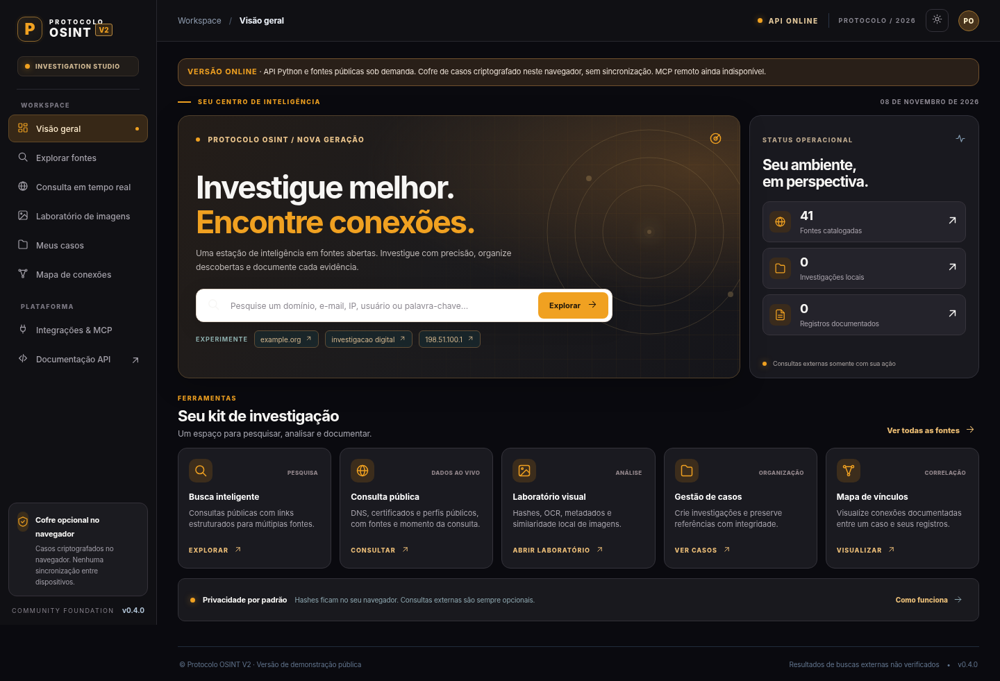

# Protocolo OSINT V2 — Intelligence Workspace

**V2 v0.4.0 · Interface Aurum UI · Pesquisa em fontes abertas com origem e contexto.**

> Esta versão contém código novo, separado da base HTML legada enquanto a titularidade e a licença do material original são revisadas. O repositório pode estar visível publicamente, mas **a licença open source do código próprio ainda não foi definida**. Não confundir visibilidade pública com concessão de direitos de reutilização. Consulte [procedência](docs/IP_PROVENANCE.md) e [critério de publicação](docs/RELEASE_GATE.md).



## Comece no navegador — sem instalar Python ou Git

A interface da V2 está preparada para a Vercel, com os arquivos estáticos em `public/` e o backend público **FastAPI** em `app.py`.

A hospedagem depende de o projeto Vercel estar conectado ao repositório correto e de um deployment concluído. Consulte [GUIA VERCEL](docs/HOSTING_VERCEL.md). **O código armazenado no GitHub não comprova que um domínio de produção já tenha sido atualizado.**

### Matriz de funcionalidades

| Capacidade | No navegador/na Vercel | Local/worker dedicado | Validação nesta revisão |
|---|---|---|---|
| Dashboard compacto Aurum e temas | disponível | disponível | Chromium renderizado com mocks, desktop e 390px |
| Catálogo de 41 fontes e planejamento de consultas | disponível | disponível | testes de API com fixtures |
| Consulta pública DNS A/MX/NS | conector HTTP sob demanda | mesmo conector | testes simulados; upstream não confirmado ao vivo |
| Certificados CT via crt.sh | conector HTTP sob demanda | mesmo conector | testes simulados; upstream não confirmado ao vivo |
| Perfis públicos GitHub | conector HTTP sob demanda | mesmo conector | testes simulados; perfil não confirma identidade |
| SHA-256 e dHash de imagens | no navegador, sem upload externo | Pillow no backend local | testes sintéticos; não é busca reversa global |
| Casos, evidências e grafo | cofre criptografado no navegador, sem sync | SQLite local, sem autenticação multiusuário | roundtrip AES-GCM e API local testados |
| Sherlock, Maigret, subfinder, Amass | **não executados na Vercel** | adaptadores opcionais de CLI, execução desativada por padrão | comandos testados com subprocess simulado |
| SpiderFoot | não | necessita serviço separado | inventariado; execução não implementada |
| OCR de imagens | não | Tesseract opcional | não validado ponta a ponta com Tesseract |
| MCP | não há MCP público | stdio de leitura experimental | JSON-RPC básico testado, interoperabilidade externa pendente |
| IA, agentes, busca reversa global | planejados | planejados | não implementados |

### Como funciona o cofre local

Nos sites HTTPS, você pode criar uma senha de **no mínimo 10 caracteres**, desbloquear o cofre e registrar casos, referências com SHA-256, hashes de imagens e grafos. O conteúdo é criptografado com **AES-256-GCM**, chave derivada com **PBKDF2/SHA-256** e salvo somente no armazenamento do navegador atual. Senhas e casos **não são enviados ao servidor**. O navegador não sincroniza dispositivos: **exporte backups periodicamente**. Os arquivos JSON exportados são **texto claro** e devem ser guardados com proteção. Caso perca a senha, não há recuperação automática. O cofre não substitui um sistema corporativo de cadeia de custódia e controle multiusuário.

### Consultas externas

A plataforma nunca procura automaticamente em todos os sites. A aba **Consulta em tempo real** envia a informação inserida **somente ao provedor explicitamente selecionado**, após clicar em **Consultar fonte**. São solicitações a endpoints fixos; as respostas não são dados pessoais verificados nem prova de identidade. Links do catálogo abrem sites de terceiros manualmente. Use apenas dados e finalidades permitidos por lei e pelos termos das fontes.

### Desenvolvimento local opcional

Se precisar de OCR, SQLite local, MCP stdio e motores de CLI, use Python 3.11+:

```bash
cd backend
python -m venv .venv
source .venv/bin/activate
python -m pip install -e '.[test]'
uvicorn protocolo_osint.main:app --host 127.0.0.1 --port 8000
```

Acesso local: `http://127.0.0.1:8000`. Nunca exponha `main.py` à internet: a API local é single-user e não possui autenticação.

Para verificar testes e preparar os arquivos Vercel:

```bash
python -m pytest -q backend/tests
node --check apps/web/assets/app.js
node --check apps/web/assets/vault.js
python scripts/build_vercel.py --output public
```

Os adaptadores locais são opcionais, **não instalados automaticamente**. A configuração `OSINT_ENABLE_LOCAL_ENGINES=1` só deve ser usada em ambiente privado e controlado, depois de instalar e revisar cada ferramenta. Não habilite esse modo na Vercel.

## Arquitetura e documentos

- `apps/web/` — interface original do Protocolo OSINT, HTML/CSS/JS sem build, incluindo Aurum UI e cofre AES-GCM.
- `public/` — artefato versionado para Vercel (gerado por `scripts/build_vercel.py`).
- `app.py` e `backend/src/protocolo_osint/hosted_api.py` — API pública de consultas, sem armazenamento de casos.
- `backend/src/protocolo_osint/main.py` — backend local completo single-user; SQLite e mídia.
- `backend/src/protocolo_osint/live_lookup.py` — consultas de endpoints fixos, sem SSRF arbitrário.
- `backend/src/protocolo_osint/local_engines.py` — adaptadores opcionais para CLIs de terceiros (sem código copiado).
- `docs/` — [Design System](docs/DESIGN_SYSTEM_AURUM.md), [Integrações](docs/INTEGRATIONS_V04.md), [Arquitetura](docs/ARCHITECTURE.md), [Hospedagem](docs/HOSTING_VERCEL.md), [Roadmap](docs/ROADMAP.md), [Proveniência](docs/IP_PROVENANCE.md).

A evolução segue o princípio **preservar, testar, migrar e ampliar**. A V2 ainda não reproduz integralmente as funcionalidades do HTML legado; a análise de cobertura continua em [`docs/LEGACY_COVERAGE.md`](docs/LEGACY_COVERAGE.md).


## V0.5 — Obsidian Red / Engine Studio

A interface de desenvolvimento inclui o tema próprio **Obsidian Red** (preto, vermelho e branco), microinterações acessíveis com `prefers-reduced-motion` e painel de cinco motores de terceiros. Não são apresentados resultados simulados como buscas reais.

- `GET /api/v1/engines` — status **efetivo** dos executáveis instalados (inventário somente leitura).
- `POST /api/v1/engines/run` — execução limitada de Sherlock, Maigret e subfinder, **desabilitada por padrão**. Precisa de `OSINT_ENGINE_EXECUTION_ENABLED=1` e `OSINT_ENGINE_TOKEN` seguro, apenas no servidor. Não exponha este token no repositório, páginas ou logs; sem autenticação por usuários, cotas distribuídas e proteção antiabuso, não permita acesso público a esse recurso.
- Sherlock `0.16.2` e Maigret `0.6.6`: declarados como dependências pip fixadas de `requirements.txt`, com suas licenças mantidas. Instalado **não é igual a operacionalmente validado**.
- subfinder, OWASP Amass e SpiderFoot: a imagem experimental `deploy/engines/Dockerfile` é um **plano de implantação**, não um worker de produção. Sua disponibilidade no catálogo não significa execução no site.
- `apps/web/assets/obsidian.css`, `apps/web/assets/engine-ui.js` e as versões sincronizadas em `public/assets/` preservam os módulos existentes sem substituição destrutiva.
- Testes: ver `backend/tests/test_engine_hub.py` e `backend/tests/test_hosted_engines.py`; checks de CI devem passar antes do merge. Estado de produção deve ser verificado por URL e logs reais.


## V0.6 — Monochrome Signal / laboratório avançado

- **Visual**: paleta neutra preto/branco/cinza com um só vermelho de ação; sem degradês coloridos, ícones emoji ou animações contínuas. Nova camada `monochrome.css` preserva a interface existente.
- **Similaridade reversa local**: compara dHash de uma imagem selecionada com imagens documentadas em todos os casos do cofre AES-GCM desbloqueado. Não faz buscas na internet nem envia a imagem a terceiros.
- **OCR**: Tesseract.js 6.0.1, Apache-2.0; motor WebAssembly e idiomas português + inglês baixados **somente depois do clique**. A foto é processada no navegador. A instalação remota/idiomas pode falhar se houver bloqueio de CDN.
- **Busca reversa na web**: integração opcional com Google Cloud Vision `WEB_DETECTION` documentada em `docs/IMAGE_INTELLIGENCE_V06.md`. Sem chave e token no servidor, o botão fica desabilitado e nenhuma foto é enviada. O Google é um provedor externo pago, não parte do código aberto.
- **Testes**: `node tests/test-image-core.cjs`, `backend/tests/test_reverse_image.py` e `backend/tests/test_hosted_reverse.py`. Integrações de fornecedor precisam de validação externa; não proclamar OCR ou Web Detection verificados ao vivo sem esse passo.

A implantação pública não expõe o banco SQLite, caso privado nem tokens. O CI deve passar antes da publicação de novas versões. Consulte `docs/DESIGN_SYSTEM_MONO_V06.md`.


## V0.7 MCP customizado (experimental)

A aba Integrações & MCP aceita URL HTTPS, token Bearer opcional, handshake, listagem de ferramentas e chamada com JSON e confirmação. A comunicação é direta do navegador para o servidor escolhido, sem proxy e sem guardar tokens. Presets GitHub/Cloudflare/Pesquisa são modelos de conexão SEM URL/credenciais prontas. CORS do servidor MCP é obrigatório. Stdio, OAuth, SSE contínuo e conexão a qualquer MCP não são garantidos. Não inserir credenciais administrativas em servidores desconhecidos. Ver docs/MCP_CUSTOM_V07.md.


## v0.8 — MCP v2 oficial e workers OSINT isolados

A API agora pode servir **MCP Streamable HTTP de leitura** no caminho `/mcp/` (SDK oficial `mcp==2.3.0`), com `osint_classify`, `osint_plan_sources` e `osint_list_sources`. Nunca expõe casos, tokens nem comandos remotos. O servidor é independente do cliente MCP customizado já existente. O transporte 2026-07-28 e a compatibilidade legada são gerenciados pelo SDK, mas a conexão live de clientes de terceiros depende dos testes de hospedagem.

Os cinco motores são empacotáveis em um **único container worker**: Sherlock, Maigret, subfinder, OWASP Amass e SpiderFoot. Arquivos: `engine_worker_runtime.py`, `engine_queue.py`, `deploy/engines/Dockerfile.daemon`. Execução em `Vercel Daemons` com fila Vercel Queues e resultados Private Blob é caminho suportado pela arquitetura, mas está **desativado por padrão**, sem criação de instância contínua nem cobrança iniciada. O arquivo `vercel-daemons.example.json` é referência de implantação, não configuração ativa. Um usuário terá de se autenticar para solicitar cada trabalho. Testes de subprocessos e filas usam simulação; build Docker/execução real são verificados na workflow separada de supply chain.


## v0.8.1 — Visibilidade de motores reais

O inventário na tela de Motores de pesquisa passa a combinar presença local do executável na API e heartbeat recente do Daemon privado, sem inventar instalação. Ao detectar heartbeat válido (menos de 180s), mostra `WORKER ATIVO` e direciona à fila autenticada; o botão HTTP síncrono permanece desabilitado para o motor externo. Um heartbeat não comprova sucesso de investigação, apenas presença do worker. Sem Daemon/Queue/Private Blob configurados, status permanece pendente.


## v0.9 — Diagnóstico operacional no painel

Em Motores de pesquisa, o diagnóstico da API apresenta fila, autorização, armazenamento privado e daemon em estados separados. A interface só habilita envio de novas tarefas se todos os pré-requisitos detectáveis estiverem presentes, inclusive heartbeat recente. A autenticação continua obrigatória e uma tarefa enviada não prova que fontes externas responderam. O publisher/consumer da Queue compartilha a região gru1 e o namespace de todos os deployments, evitando isolamento acidental entre releases de Function/Daemon. Os cinco motores foram testados como executáveis em Docker CI; a execução real depende de infraestrutura e autenticação na conta Vercel rodrigo11. Nenhum recurso pago foi ativado por este commit.
