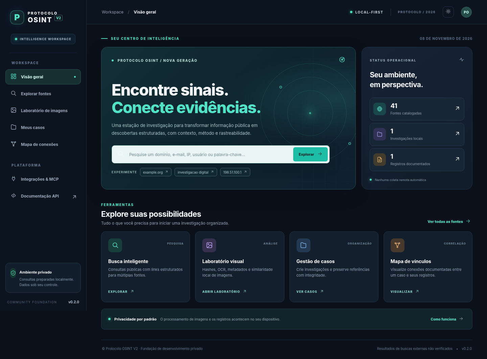

# Protocolo OSINT V2 — Intelligence Workspace

> **PRÉVIA PRIVADA · v0.2.0.** Plataforma local-first de pesquisa em fontes abertas. **Ainda não pronta para publicação pública**, sobretudo por pendências de procedência e licença da versão original. Não contém cópia do sistema legado nem código de ferramentas OSINT de terceiros.



## Funcionalidades disponíveis agora

| Módulo | Estado | Como foi verificado |
|---|---|---|
| Painel responsivo, navegação e tema | Prévia funcional | JS executado em Chromium com respostas locais simuladas; navegação HTTP direta bloqueada no ambiente de testes |
| Detecção de termos (IP, domínio, e-mail, URL, username, texto) | Testado | pytest/TestClient |
| Catálogo de 41 fontes, em 12 categorias | Testado localmente | URLs HTTPS construídas; **destinos não acessados nem validados** |
| Pesquisa com links por tipo de termo | Testado localmente | planejamento sem requisições externas |
| Casos e registros locais | Testado | SQLite: criar, consultar, registrar evidências, exportar JSON |
| SHA-256, dHash e metadados de imagens | Testado | imagem sintética PNG; sem armazenamento de pixels |
| OCR local | Implementado, dependente de Tesseract | Teste unitário usou OCR desativado; não validado ponta a ponta com Tesseract |
| Busca de similares em caso | Testado | distância de dHash em imagens sintéticas |
| Mapa de registros documentados | Testado parcialmente | API e SVG na simulação visual |
| MCP local via stdio | Experimental | Testado o JSON-RPC local; compatibilidade com clientes MCP externos não validada |
| Sherlock, Maigret, SpiderFoot, IA, busca reversa global | **Não implementado** | São módulos do roadmap; não são apresentados como funcionais |

### Inicie a V2 hoje — sem Node.js

Requer **Python 3.11+**. Em Linux/macOS:

```bash
cd backend
python -m venv .venv
source .venv/bin/activate
python -m pip install -e '.[test]'
uvicorn protocolo_osint.main:app --host 127.0.0.1 --port 8000
```

Abra **http://127.0.0.1:8000**. A documentação da API estará em **http://127.0.0.1:8000/api/docs**.

No PowerShell (Windows), ative o ambiente com `.venv\Scripts\Activate.ps1` e use o mesmo comando `uvicorn`. Se o Python não reconhecer o comando, utilize `python -m uvicorn ...`.

#### Opcional: OCR local

Instale o aplicativo **Tesseract OCR** no sistema operacional e instale `pip install -e '.[ocr]'` no diretório `backend`. Para desabilitar por completo use `OSINT_OCR_ENABLED=0`. Se não estiver disponível, a interface mostrará `OCR indisponível`; o restante do laboratório continua funcional.

#### Opcional: Docker

```bash
docker compose up --build
```

Abra **http://127.0.0.1:8000**. O serviço é exposto somente na interface loopback do computador hospedeiro e os registros ficam no volume Docker `osint_data`. **Não exponha esta API publicamente sem autenticação, controle de acesso e revisão de segurança.**

### Testar

```bash
cd backend
python -m pip install -e '.[test]'
pytest -q
cd ..
node --check apps/web/assets/app.js
```

O painel principal não precisa de npm. Um protótipo React/TypeScript anterior foi preservado em `apps/react-foundation/` como referência para eventual migração; **não** é o frontend executado por padrão.

### Privacidade e limitações

- Classificação de termos, planejamento de links e inspeção de imagens não fazem requisições a terceiros.
- Ao **clicar em uma fonte externa**, o navegador visita aquele provedor; verifique os termos e evite consultas indevidas.
- A aplicação armazena casos e metadados no SQLite local (padrão: `~/.local/share/protocolo-osint-v2/`). Defina `OSINT_DATA_DIR` para alterar.
- Imagens originais não são gravadas. Se o usuário selecionar um caso, serão gravados somente hashes, dimensões, nome e resumo, que podem ainda ser sensíveis.
- O hash de um **registro** não equivale à preservação da página externa como evidência forense; isto será implementado separadamente.
- O servidor é **single-user**, sem autenticação. Use somente em `127.0.0.1`; não o exponha em rede pública.
- Não garante anonimato, veracidade de informações de fontes externas ou busca reversa global de imagens.

## Prévia web via GitHub Pages

A publicação estática é gerada automaticamente por GitHub Actions após a configuração do GitHub Pages e commits revisados na branch `main`. Essa versão funciona sem instalação para catálogo de buscas e análise de hashes de imagens no próprio navegador, **mas não executa backend, casos persistentes, OCR, EXIF avançado ou MCP**. Veja [GUIA DE PUBLICAÇÃO](docs/GITHUB_PAGES.md).

## Arquitetura e comunidade

- `apps/web/`: frontend estático independente de build (HTML/CSS/JS).
- `backend/`: API FastAPI + SQLite + análise de mídia + catálogo de fontes.
- `apps/react-foundation/`: protótipo anterior preservado, não ativo.
- `docs/`: arquitetura, proveniência, validação, roadmap e políticas.
- `.github/workflows/`: testes de regressão.

Veja [ARQUITETURA](docs/ARCHITECTURE.md), [VALIDAÇÃO](docs/VALIDATION.md), [ROADMAP](docs/ROADMAP.md) e [PROCEDÊNCIA](docs/IP_PROVENANCE.md). O código novo está sendo elaborado para um projeto open source, mas a licença final depende da revisão de direitos e componentes de terceiros.
